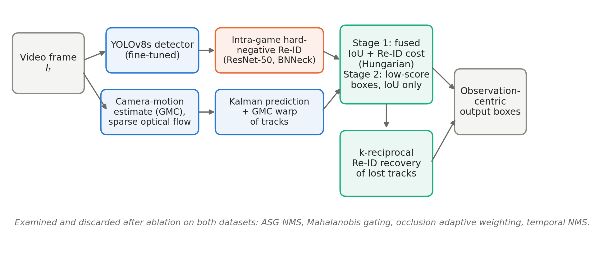

# OAF-Track

**Observation-Centric, Appearance-Fused Multi-Object Tracking with Intra-Game Hard-Negative Re-Identification for Sports and Dance Scenes**

Official code for the paper *(under review)*. This repository contains the complete pipeline used for every number in the paper:

- detector fine-tuning
- Re-ID training
- the tracker and five re-implemented baselines
- TrackEval-exact evaluation
- the leave-one-out ablation
- test-set submission files



## Main results

All trackers receive **identical detections and identical Re-ID features**. The comparison therefore isolates the association logic.

| Dataset (split) | HOTA | DetA | AssA | MOTA | IDF1 | IDSW |
|---|---|---|---|---|---|---|
| SportsMOT (val) | 73.2 | 85.1 | 63.0 | 93.4 | 75.2 | 859 |
| DanceTrack (val) | 45.8 | 69.6 | 30.3 | 79.5 | 44.8 | 2626 |
| DanceTrack (test, official Codabench server) | 45.8 | 73.2 | 28.7 | 83.5 | 44.0 | 3081 |

Intra-game Re-ID retrieval within each video (Table 7):

| Dataset | Features | mAP | Rank-1 |
|---|---|---|---|
| SportsMOT val | ImageNet ResNet-50 | 26.2 | 36.3 |
| SportsMOT val | Intra-game Re-ID (ours) | **57.0** | **73.1** |
| DanceTrack val | ImageNet ResNet-50 | 20.7 | 28.7 |
| DanceTrack val | Intra-game Re-ID (ours) | **34.2** | **51.1** |

Every table in the paper is in [`results/`](results) as CSV.

> **SportsMOT test set.** The official SportsMOT evaluation server (CodaLab) no longer accepts submissions. SportsMOT is therefore reported on the validation split. Only the *train* split is ever used for training (detector and Re-ID). The configuration was selected by ablation on both datasets, and its DanceTrack test score equals its validation score.

## Repository layout

```
OAF-Track/
├── notebooks/
│   ├── sportsmot/
│   │   ├── 1_FineTune_Detector_SportsMOT.ipynb   # YOLOv8s on SportsMOT train  -> detector_final.pt
│   │   ├── 2_ReID_Train_SportsMOT.ipynb          # intra-game hard-negative Re-ID -> reid/sportsreid_r50.pth
│   │   └── 3_OAF_Track_SportsMOT.ipynb           # trackers, evaluation, ablation, per-sport, test submission
│   └── dancetrack/
│       ├── 0_Extract_DanceTrack.ipynb            # unpack the official zips
│       ├── 1_FineTune_Detector_DanceTrack.ipynb
│       ├── 2_ReID_Train_DanceTrack.ipynb
│       └── 3_OAF_Track_DanceTrack.ipynb
├── results/          # CSV of Tables 3–9 of the paper
├── docs/figures/     # Figs. 1–3 of the paper
├── requirements.txt
├── CITATION.cff
└── LICENSE
```

Each notebook is self-contained, so no package needs installing from this repo. **Only the configuration cell (Cell 2, or Cell 1 in the Re-ID notebooks) needs editing**: set `DATA_ROOT` and `WORK_DIR`.

## Installation

```bash
git clone https://github.com/shanthinisampath2-creator/OAF-Track.git
cd OAF-Track
conda create -n oaftrack python=3.10 -y && conda activate oaftrack
pip install torch torchvision --index-url https://download.pytorch.org/whl/cu121   # pick the build for your CUDA
pip install -r requirements.txt
jupyter lab
```

A CUDA GPU is strongly recommended for detector fine-tuning and Re-ID training. The tracking itself runs on a CPU at ≈350 FPS on cached detections.

## Data

| Dataset | Source | Expected location (default) |
|---|---|---|
| SportsMOT | https://github.com/MCG-NJU/SportsMOT | `data/SportsMOT/` (any level of `sportsmot_publish/dataset/{train,val,test}` is found automatically) |
| DanceTrack | https://github.com/DanceTrack/DanceTrack | `data/DanceTrack/` with the downloaded `train1.zip, train2.zip, val.zip, test1.zip, test2.zip`, then run `0_Extract_DanceTrack.ipynb` |

Each sequence folder must contain `img1/`, `seqinfo.ini` and, for train/val, `gt/gt.txt` (MOTChallenge format). For the per-sport breakdown (Table 9), keep SportsMOT's `splits_txt/` folder.

## Pre-trained weights

These files are on the [Releases](../../releases) page. Put them in the paths below, and the notebooks will pick them up automatically:

| File in the release | Copy to |
|---|---|
| `sportsmot_detector_final.pt` | `outputs/sportsmot/detector_final.pt` |
| `sportsmot_sportsreid_r50.pth` | `outputs/sportsmot/reid/sportsreid_r50.pth` |
| `dancetrack_detector_final.pt` | `outputs/dancetrack/detector_final.pt` |
| `dancetrack_sportsreid_r50.pth` | `outputs/dancetrack/reid/sportsreid_r50.pth` |

If you use the released weights, skip steps 1 and 2 below.

## Reproducing the paper

Run the notebooks of each dataset in order, top to bottom.

**SportsMOT**
1. `1_FineTune_Detector_SportsMOT.ipynb` trains YOLOv8s on train (1280 px, every 5th frame, 30 epochs). It saves `detector_final.pt`.
2. `2_ReID_Train_SportsMOT.ipynb` extracts player crops from train, trains ResNet-50 + BNNeck with intra-game P×K sampling (P = 16, K = 4, M = 2 matches per batch), and evaluates within-video retrieval on val. It saves `reid/sportsreid_r50.pth` and `reid/reid_results.txt` (Table 7).
3. `3_OAF_Track_SportsMOT.ipynb`:
   - **Cells 1–8:** detection, Re-ID and GMC caching, then the trackers and metrics. Check that Cell 3 prints `detector_final` and `sportsreid`.
   - **Cell 9:** comparison table (Table 3) → `results/<tag>/comparison_table.csv`
   - **Cell 10:** leave-one-out ablation (Table 8) → `ablation_table.csv`
   - **Cell 11:** per-sport breakdown (Table 9) → `per_sport_table.csv`
   - **Cell 12:** figures and `summary.md`
   - **Cell 14:** MOTChallenge-format test submission zip

**DanceTrack:** run notebooks 0 → 3 the same way. Cell 14 of `3_OAF_Track_DanceTrack.ipynb` writes the zip that was submitted to the official server (https://www.codabench.org/competitions/14885/; submission ID 966261).

Cached detections and results are checkpointed. An interrupted run resumes where it stopped (`RESUME = True` in Cell 2).

## Tracker configurations

In `3_OAF_Track_*.ipynb` (Cell 7):

| Name in the tables | Modules |
|---|---|
| `OAF-Track` (paper configuration) | Kalman + GMC, two-stage Hungarian on fused IoU/Re-ID cost (w = 0.5), k-reciprocal recovery (k = 1), observation-centric output |
| `OAF-Track (full, 8 modules)` | the above **plus** ASG-NMS, Mahalanobis gating, occlusion-adaptive weighting, tracklet-level temporal NMS |

The four extra modules are switched with the `OAFTrack(...)` arguments `asg_nms`, `maha`, `adaptive` and `tnms`. The ablation arguments are `reid`, `recovery`, `gmc` and `obs_out`. Baselines: IoU-Tracker, SORT, ByteTrack, OC-SORT, BoT-SORT, re-implemented with the association logic of the original papers.

## Evaluation

Cell 8 contains an exact re-implementation of TrackEval's MOTChallenge HOTA, CLEAR-MOT and Identity metrics, so no TrackEval install is needed. The notebook checks it by evaluating ground truth against itself (must give 100 %). The tracker `.txt` files are standard MOTChallenge format and can also be scored with the official [TrackEval](https://github.com/JonathonLuiten/TrackEval).

## Citation

```bibtex
@article{oaftrack2026,
  title   = {OAF-Track: Observation-Centric, Appearance-Fused Multi-Object Tracking with Intra-Game Hard-Negative Re-Identification for Sports and Dance Scenes},
  author  = {<Authors>},
  journal = {<Journal>},
  year    = {2026},
  note    = {Under review}
}
```

## Acknowledgements

This work builds on [SportsMOT](https://github.com/MCG-NJU/SportsMOT), [DanceTrack](https://github.com/DanceTrack/DanceTrack), [Ultralytics YOLOv8](https://github.com/ultralytics/ultralytics), [ByteTrack](https://github.com/ifzhang/ByteTrack), [OC-SORT](https://github.com/noahcao/OC_SORT), [BoT-SORT](https://github.com/NirAharon/BoT-SORT), [TrackEval](https://github.com/JonathonLuiten/TrackEval) and the BNNeck Re-ID baseline of Luo et al. (2019). Dataset licences apply to the data and to models trained on it.

## License

Code: MIT (see `LICENSE`). Released weights are provided for research use. YOLOv8 is AGPL-3.0, so check Ultralytics' licence before commercial use.
